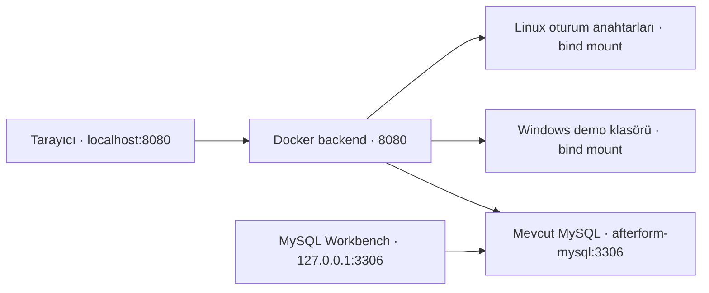

# 10. adım — Backend'i Docker'da çalıştırma ve veri kalıcılığı

**Durum: tamamlandı.** Kullanıcı 2 Ekim 2026'da normal PowerShell'de `afterform-api:local` imajını oluşturdu ve `afterform-backend-1` konteynerini **healthy** durumunda başlattı. Terminal çıktısı ile `.local/docker/last-start.json` okundu: durum `ready`, MySQL `connected`, şema `upToDate`. Mevcut MySQL'in `/var/lib/mysql` dizini **mysql_data** adlı volume'a bağlı. Başlatma özeti [10-last-start.md](C:/Users/Windows11/Documents/Codex/2026-09-27/sen/docs/10-last-start.md) dosyasında.

Backend Release publish, PowerShell sözdizimi ve Docker Compose yapılandırması kontrolleri de başarılı. Tanıtım sitesi ve sanatçı sayfaları publish çıktısında mevcut. Docker motoruna bu çalışma ortamından erişim reddedildiğinden gerçek imaj oluşturma ve başlatma kullanıcı terminalinde yapıldı; ajan çıktıyı ve oluşan raporu okuyarak doğruladı.

Bu aşama bilgisayarında HTTP ile çalışan yerel geliştirme içindir. Azure yayını veya üretim HTTPS kurulumu yapılmadı. 9. adımın başarılı API raporu önceki yerel .NET sunucusuna aittir; aynı güvenlik koleksiyonu Linux konteynerinde yeniden çalıştırılmadı.

## 1. Tek komutla başlat

Docker Desktop açık, Linux containers modunda olmalı. Mevcut MySQL konteynerin kullanılır. Normal PowerShell pencerende şu satırı çalıştır:

```powershell
C:\Users\Windows11\Documents\Codex\2026-09-27\sen\scripts\Start-BackendDocker.ps1 -ContainerName 688c9576f123
```

İlk çalıştırma Microsoft .NET imajlarını ve NuGet paketlerini indireceği için birkaç dakika sürebilir. İlerleme terminalde görünür. Beklenen son satır:

```text
Tamamlandi: http://localhost:8080/ / MySQL connected / schema upToDate.
```

Ardından [tanıtım sitesini](http://localhost:8080/) veya [sanatçı girişini](http://localhost:8080/artist/login/) aç. Mevcut sanatçı kullanıcı adını ve parolanı kullan. Linux'un anahtar klasörü farklı olduğu için ilk geçişte yeniden giriş yapman gerekir.

Bu kez terminalde sürekli `Now listening on` beklemen gerekmez: backend Docker'da arka planda çalışır. Komut başarıyla bittikten sonra PowerShell'i kapatabilirsin. Docker Desktop ve MySQL çalışmaya devam etmelidir.

8080 kullanımdaysa `-Port 8081` ekle. Site adresi buna göre değişir. 5000'deki önceki .NET sunucusu ayrı çalışabilir; ancak çerezler portlara göre ayrılmadığından iki `localhost` sürümünde aynı anda giriş yapmak oturumlarını etkileyebilir. Günlük kullanımda Docker sürümünü kullan; eski sunucuyu kendi terminalinde Ctrl+C ile durdurabilirsin.

### Başlatma betiği ne yapar?

1. Docker motorunu ve Compose'u kontrol eder; kısa motor kontrolleri sınırsız beklemez.
2. Verdiğin MySQL kimliğini kayıtlı bağlantıyla karşılaştırır. `/var/lib/mysql` için yazılabilir bir volume veya bind mount bulunduğunu okur. Kalıcı bağlantı bulunmazsa veritabanını taşımadan durur.
3. `afterform-local` adlı bridge ağı oluşturur ve mevcut MySQL'e `afterform-mysql` DNS adını ekler. Mevcut MySQL'in diğer ağ bağlantıları korunur.
4. `.local/backend.settings.json` içindeki mevcut **uygulama** bağlantısından Docker için bir sır dosyası üretir. Sunucu adresini `afterform-mysql`, portu 3306 yapar. Parola ekrana yazılmaz; root ve migration bağlantıları bu dosyaya alınmaz.
5. Backend'i derleyip `afterform-api:local` imajından konteyner açar. Bu Compose projesi yalnızca backend'i yönetir; mevcut MySQL kendi konteynerinde çalışır.
6. Docker sağlık kontrolü ve host üzerindeki readiness isteği, gerçek MySQL bağlantısını ve bekleyen migration olmadığını denetler. Sonuç `.local/docker/last-start.json` içinde saklanır; parola içermez.

Yeni tablo değişikliği yok; bu adım migration çalıştırmaz. İleride şema değişirse mevcut `Update-Database.ps1` normal PowerShell'de ayrı çalıştırılabilir.

## 2. Hangi veri nerede duruyor?

| Veri | Kalıcı konum | Backend içindeki adres |
|---|---|---|
| Hesaplar, parola hash'leri, demo bilgileri | Mevcut MySQL'in `/var/lib/mysql` dizinine bağlı `mysql_data` volume'u | `afterform-mysql:3306`, `afterform` veritabanı |
| Demo dosyalarının orijinal baytları | `C:\Users\Windows11\Documents\Codex\2026-09-27\sen\.local\uploads\demos` | `/var/afterform/demos` |
| Linux oturum ve CSRF anahtarları | `C:\Users\Windows11\Documents\Codex\2026-09-27\sen\.local\docker\data-protection` | `/var/afterform/keys` |
| Uygulama veritabanı bağlantısı | `.local/docker/backend.settings.json` | `/run/secrets/afterform_runtime`, salt okunur |
| Site ve backend kodu | Docker imajının publish çıktısı | `/app`, site `/app/wwwroot` altında |

**Demo klasörü bind mount kullanır.** Windows'taki mevcut klasör Linux konteynerine bağlanır; şarkıları kopyalamak veya boş bir volume'a geçirmek gerekmez. Önceki QA dosyaları ve gerçek yüklemeler aynı klasördedir. Backend konteyneri yeniden oluşturulsa da klasör bilgisayarında kalır. [Docker bind mount açıklaması](https://docs.docker.com/engine/storage/bind-mounts/).

**MySQL kendi mevcut kalıcı bağlantısını kullanır.** Betik bunun türünü ve volume adını kaydeder. Anonymous volume varsa Docker adı uzun bir kimlik olabilir; yeniden kurulacak MySQL'in aynı volume'u kullanması gerekir. Başka bir boş volume bağlamak eski kayıtları getirmez. [Docker volume açıklaması](https://docs.docker.com/engine/storage/volumes/).

Konteynerin yeniden oluşturulması ile veri klasörünün veya volume'un silinmesi farklı işlemlerdir. Kalıcılık yedekleme değildir: bilgisayar diski kaybolursa bu dosyalar da kaybolabilir.

## 3. Docker ağını nasıl anlamalısın?



Konteynerin içindeki `localhost`, o konteyneri gösterir. Bu yüzden backend'e `Server=127.0.0.1` vermiyoruz; ortak ağdaki **afterform-mysql** adını kullanıyoruz. IP değişse de ağdaki ad üzerinden bağlantı kurulur. Workbench bilgisayarında çalıştığı için mevcut `127.0.0.1:3306` bağlantısını kullanmaya devam eder. [Docker Compose ağ rehberi](https://docs.docker.com/compose/how-tos/networking/).

Tarayıcı aynı adres üzerinden HTML, CSS, JavaScript ve API'ye ulaşır. Ön yüzde API adresi değiştirilmedi; ayrı CORS kurulumu gerekmedi.

## 4. Günlük kullanabileceğin komutlar

### Durumu gör

```powershell
C:\Users\Windows11\Documents\Codex\2026-09-27\sen\scripts\Manage-BackendDocker.ps1 -Action Status
```

Başarılı başlatma sonrası backend için `healthy` görülür. Docker Desktop'ın Containers bölümünde `afterform` projesini de görebilirsin.

### Son logları oku

```powershell
C:\Users\Windows11\Documents\Codex\2026-09-27\sen\scripts\Manage-BackendDocker.ps1 -Action Logs
```

Son 100 log satırını gösterir. Logları paylaşırken parola veya bağlantı dosyasını eklemene gerek yok.

### Backend'i durdur

```powershell
C:\Users\Windows11\Documents\Codex\2026-09-27\sen\scripts\Manage-BackendDocker.ps1 -Action Stop
```

MySQL ayrı çalışır; veriler ve bağlı klasörler yerlerinde kalır. Yeniden başlatmak için ilk bölümdeki `Start-BackendDocker.ps1` komutunu kullan.

### Çalışan backend'i yeniden başlat

```powershell
C:\Users\Windows11\Documents\Codex\2026-09-27\sen\scripts\Manage-BackendDocker.ps1 -Action Restart
```

### Kodu değiştirdiğinde

İlk bölümdeki `Start-BackendDocker.ps1` komutunu yeniden çalıştır. Güncel kaynaklardan imaj oluşturur ve backend konteynerini yeniler. Docker derleme önbelleği uygun katmanları tekrar kullanır. İmajdaki site dosyaları da bu sırada güncellenir.

### Kalıcılığı kendin gözlemle

Bu işlem burada henüz yürütülmedi. İlk başarılı başlatmadan sonra kendi hesabınla bir demo gönderip kimliğini not et. Ardından:

```powershell
C:\Users\Windows11\Documents\Codex\2026-09-27\sen\scripts\Manage-BackendDocker.ps1 -Action Recreate
```

Bu komut mevcut imajdan backend konteynerini yeniden oluşturur; MySQL'i yeniden oluşturmaz. Portalı yenileyip aynı demo kaydının ve ses dosyasının durduğunu gözlemleyebilirsin. Aynı anahtar klasörü kullanıldığı için geçerli Docker oturumları yeniden oluşturma sonrasında çözülebilir; normal oturum süresi ve güvenlik stamp kontrolleri yine geçerlidir.

## 5. Bu adımda güvenlikle ilgili tercihler

- **İki aşamalı imaj:** SDK katmanında restore/publish yapılır; son imaj ASP.NET runtime ve publish çıktısını içerir. SDK, Postman/Newman ve test kaynakları son imajın parçası değildir. [Microsoft Docker rehberi](https://learn.microsoft.com/en-us/aspnet/core/host-and-deploy/docker/building-net-docker-images?view=aspnetcore-10.0).
- **Build bağlamı sınırlı:** `.dockerignore` yalnızca backend kaynakları, NuGet yapılandırması ve açık ön yüz dosyalarını kabul eder. `.local`, parolalar, şarkılar, raporlar ve Windows anahtarları build'e gönderilmez.
- **Uygulama kullanıcısı:** Backend MySQL'de mevcut `afterform_app` hesabını kullanır. Sır dosyasında root veya `afterform_migrator` yetkileri bulunmaz.
- **Compose secret:** Bağlantı Dockerfile'a veya ortam değişkenine parola olarak yazılmaz; konteynere salt okunur bir dosya bağlanır. Yerel Compose secret dosyası bilgisayarında şifreli bir kasa değildir; dosyayı veya `.local` klasörünü paylaşmamalısın. [Compose secret rehberi](https://docs.docker.com/compose/how-tos/use-secrets/).
- **Uygulama süreci root değil:** Microsoft imajının `app` kullanıcısıyla çalışır. Root dosya sistemi salt okunur; yazılabilir alanlar özel demo/anahtar bağları ve geçici `/tmp` alanıdır. Linux yetenekleri düşürülür, yeni ayrıcalık kazanma kapatılır.
- **Yalnızca bilgisayarından erişim:** Host portu `127.0.0.1` adresine bağlıdır. İnternete veya yerel ağdaki diğer cihazlara yayın yapılmaz.
- **Oturum anahtarlarının kalıcılığı:** Docker'daki anahtarlar ayrı kalıcı klasöre yazılır. Windows DPAPI ile şifrelenmiş eski anahtarlar Linux'a kopyalanmaz. Linux geliştirme sürümünde bu anahtarların diskte şifrelenmesi ayrıca yapılandırılmadı; kalıcı yazım tek başına anahtar şifreleme sağlamaz. Üretimde sertifika veya Azure Key Vault ile korunması değerlendirilir. [Microsoft anahtar şifreleme açıklaması](https://learn.microsoft.com/en-us/aspnet/core/security/data-protection/implementation/key-encryption-at-rest?view=aspnetcore-10.0).

Mevcut Identity parola hash/salt, cookie, CSRF, sahiplik, dosya doğrulaması ve istek sınırı kodu kullanılır. İstek sayaçları hâlâ süreç belleğindedir; backend yeniden başlayınca sıfırlanır. Hesap kilidi MySQL'de kaldığı için süreç yeniden başlatmak kilidi kaldırmaz.

## 6. Sık karşılaşılabilecek durumlar

| Belirti | Yapılacak işlem |
|---|---|
| Docker motoruna erişim reddedildi | Normal PowerShell ve açık Docker Desktop kullan; son hata satırını paylaş |
| Compose bulunamadı | Docker Desktop kurulumunu güncelle; betik kullanıcı klasöründeki Docker Desktop'ın Compose eklentisini de tanır |
| `/var/lib/mysql` kalıcı bağlantısı yok | Mevcut veriyi silme/yeniden kurma; mount bilgisine göre ayrı veri taşıma planı gerekir |
| 8080 portu dolu | Başlatma komutuna `-Port 8081` ekle |
| İmaj indirme veya NuGet restore hatası | Docker Desktop'ın internet/proxy bağlantısını kontrol et; son build hatasını paylaş |
| Backend `unhealthy` | `-Action Logs` ile bak; MySQL çalışıyor mu ve migration tamam mı kontrol et |
| Depolamaya erişim reddedildi | Docker Desktop'ın proje klasörünü paylaşabildiğini kontrol et; uygulamayı root'a çevirme |
| İlk geçişte giriş/CSRF hatası | Docker adresindeki giriş sayfasını yenile ve yeniden giriş yap |
| `afterform-local` adı başka bir ağa ait | Betik o ağı değiştirmez; isim çakışmasını birlikte çözebiliriz |

## 7. Yedekleme için pratik başlangıç

Backend'i `Stop` ile durdurup yeni yüklemeleri kes. Workbench'te **Server → Data Export** üzerinden `afterform` şemasını dışa aktar. Aynı zamanda `.local/uploads/demos` klasörünü yedekle; veritabanı dosyanın tamamını saklamaz. MySQL ve dosya yedeğinin aynı duruma ait olması gerekir.

Windows'un `.local/data-protection` klasörüyle Docker'ın `.local/docker/data-protection` klasörü farklıdır. Oturum anahtarları ve bağlantı sırları korunmuş, ayrı erişim kontrollü yedeklerde tutulmalıdır. Bu adım otomatik yedekleme veya geri yükleme denemesi eklemedi.
